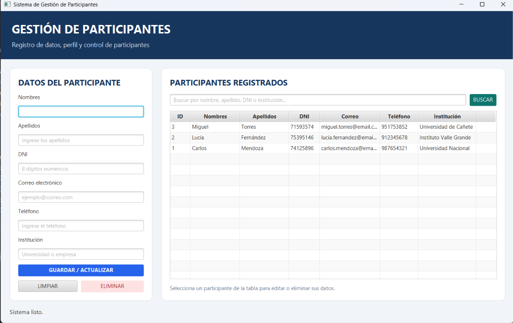
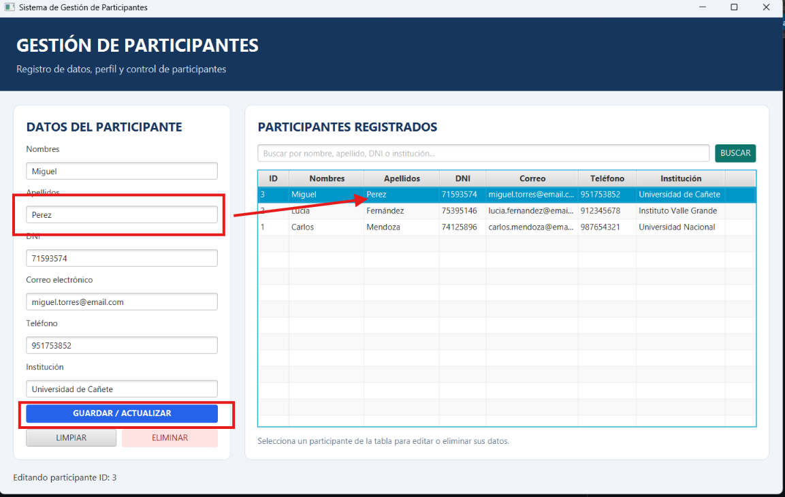
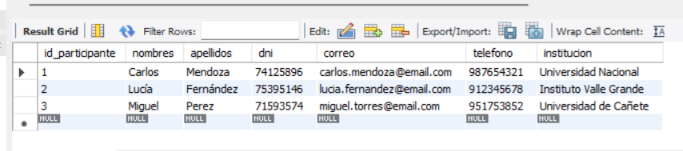
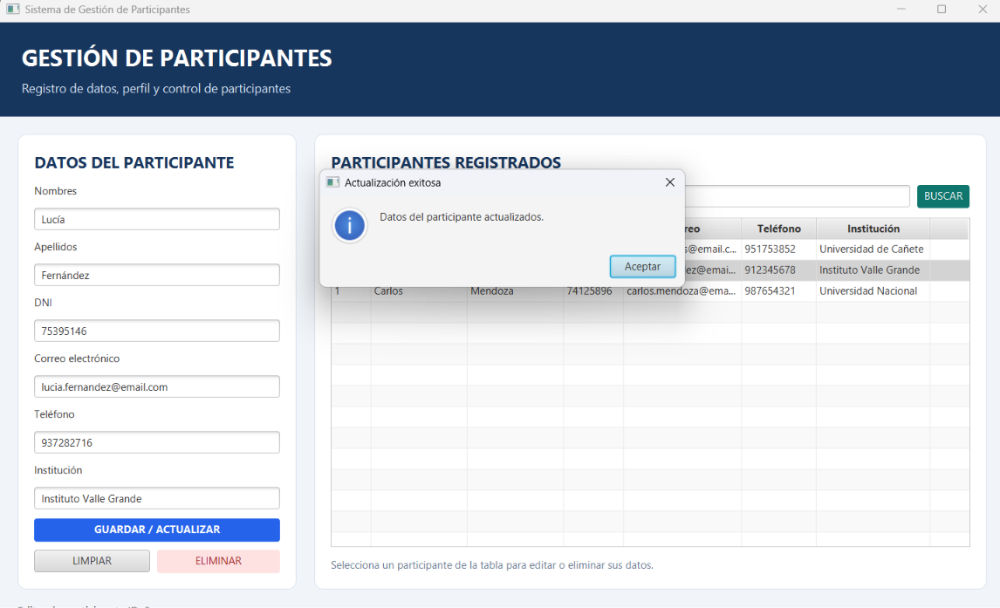
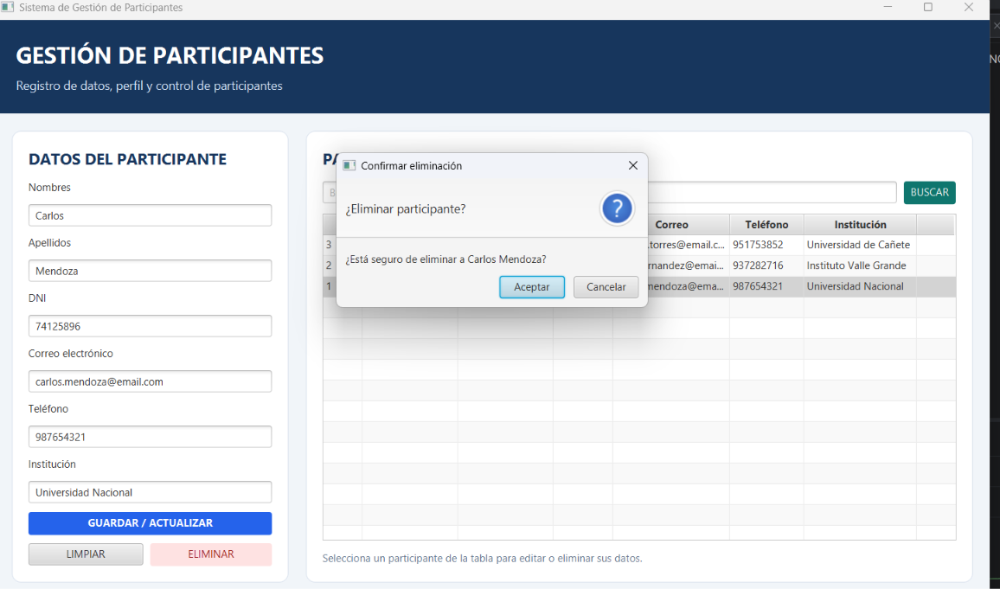
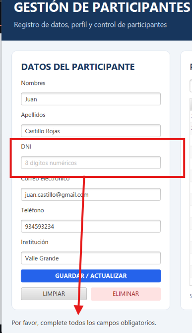
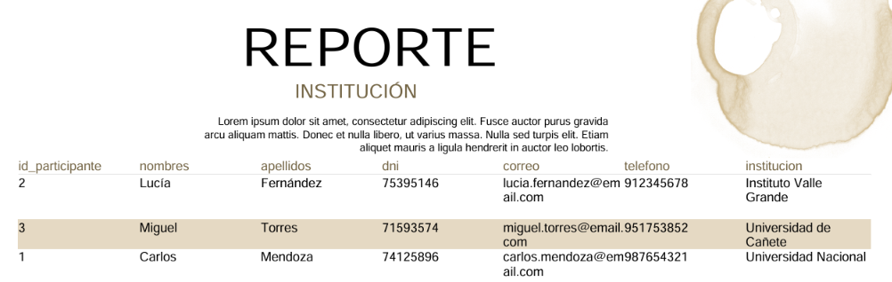

# G03_PREHACKATON_T03
## Sistema de Gestión de Eventos y Conferencias

### 1. Descripción del proyecto
Desarrollo de una aplicación de escritorio utilizando **JavaFX** y **Programación Orientada a Objetos (POO)**, con conexión a una base de datos **MySQL** mediante **JDBC**.

Este proyecto tiene como finalidad gestionar eventos y conferencias mediante operaciones CRUD de manera eficiente e intuitiva.

---

### 2. Tecnologías utilizadas
* **Lenguaje:** Java 17
* **Interfaz Gráfica:** JavaFX (FXML)
* **Gestor de Dependencias:** Maven
* **Base de Datos:** MySQL
* **Persistencia:** JDBC
* **IDE:** IntelliJ IDEA
* **Control de Versiones:** Git y GitHub

---

### 3. Módulo desarrollado: Gestión de Eventos
* **Responsable:** Luis Quispe – *Integrante 1*

Este módulo permite administrar completamente los eventos y conferencias registrados en el sistema.

#### Funcionalidades principales:
- **Registrar eventos:** Formulario para alta de nuevos eventos.
- **Visualizar eventos:** Presentación de registros en una tabla interactiva (`TableView`).
- **Buscar y filtrar eventos:** Búsqueda dinámica por nombre, fecha o criterios específicos.
- **Actualizar información:** Edición de detalles de eventos existentes.
- **Eliminar eventos:** Borrado de registros del sistema.
- **Cambiar el estado:** Control de estado (ej. *Programado*, *En curso*, *Finalizado*, *Cancelado*).
- **Validación de datos:** Control de campos obligatorios, formatos de fecha e información correcta.

---

### 4. Estructura del proyecto
El módulo se encuentra estructurado bajo la arquitectura **MVC (Modelo-Vista-Controlador)** y el patrón de diseño **DAO (Data Access Object)**:

```text
src/main/java/com/sistema/eventos/
├── model/        # Clases de dominio y representación de datos (ej. Evento.java)
├── dao/          # Interfaces y clases de acceso a datos MySQL via JDBC
├── controller/   # Lógica de negocio y control de la interfaz gráfica
└── Main.java     # Clase principal de inicio de la aplicación

src/main/resources/
└── views/        # Archivos FXML para las interfaces gráficas y archivos CSS
```

---

### 5. Instalación y ejecución

1. **Clonar el repositorio:**
   ```bash
   git clone https://github.com/tu-usuario/tu-repositorio.git
   ```
2. **Abrir el proyecto:** Importar la carpeta en IntelliJ IDEA.
3. **Configurar el JDK:** Asegurarse de tener configurado Java 17 (*Project Structure > Project SDK*).
4. **Cargar dependencias:** Permitir que Maven cargue automáticamente todas las dependencias (`pom.xml`).
5. **Configurar la base de datos:** Ajustar las credenciales en la clase de conexión JDBC.
6. **Ejecutar:** Iniciar la aplicación desde la clase principal (`Main.java`).

---

### 6. Configuración de la base de datos

* **Motor:** MySQL
* **Base de datos:** `db_eventos`
* **Mecanismo de Conexión:** JDBC

#### Parámetros de conexión:
* **Host:** `localhost`
* **Puerto:** `3306`
* **Base de datos:** `db_eventos`
* **Usuario:** *(Tu usuario de MySQL, ej. `root`)*
* **Contraseña:** *(Tu contraseña de MySQL)*

#### Estructura de la tabla `eventos`:

```sql
CREATE DATABASE IF NOT EXISTS db_eventos;
USE db_eventos;

CREATE TABLE IF NOT EXISTS eventos (
    id INT AUTO_INCREMENT PRIMARY KEY,
    nombre VARCHAR(100) NOT NULL,
    descripcion TEXT,
    fecha DATE NOT NULL,
    lugar VARCHAR(150) NOT NULL,
    modalidad VARCHAR(50) NOT NULL, -- Presencial, Virtual, Híbrido
    estado VARCHAR(50) NOT NULL     -- Programado, En Curso, Finalizado, Cancelado
);
```

---

### 7. Evidencias del sistema

*(Sube tus capturas a una carpeta `docs/images/` dentro de tu repositorio para que se muestren correctamente)*

#### 7.1. Interfaz principal


#### 7.2. Formulario de registro de eventos


#### 7.3. Listado de eventos registrados


#### 7.4. Actualización de eventos


#### 7.5. Eliminación de eventos


#### 7.6. Validaciones del sistema


#### 7.7. Reporte General de Eventos y Estados
}

### 8. Módulo desarrollado: Gestión de Participantes
* **Responsable:** Juan Jeremy Castillo Rojas – *Integrante 2*

Este módulo permite administrar completamente los participantes registrados en el sistema.

#### Funcionalidades principales:
- **Registrar participantes:** Formulario para alta de nuevos participantes.
- **Visualizar participantes:** Presentación de registros en una tabla interactiva (`TableView`).
- **Buscar y filtrar participantes:** Búsqueda dinámica por nombres, apellidos, DNI o institución.
- **Actualizar información:** Edición de detalles y perfil de participantes existentes.
- **Eliminar participantes:** Borrado seguro de registros del sistema con confirmación (`Alert`).
- **Validación de datos:** Control de campos obligatorios, formato de DNI (8 dígitos), correo electrónico válido y prevención de DNI duplicados.
- **Generar reportes:** Exportación de reporte tabular ordenado por institución mediante Jaspersoft Studio.

---

### 9. Estructura del proyecto
El módulo se encuentra estructurado bajo la arquitectura **MVC (Modelo-Vista-Controlador)** y el patrón de diseño **DAO (Data Access Object)**:

```text
src/main/java/vallegrande/edu/pe/gestion_eventos/
├── model/        # Clases de dominio y representación de datos (Participante.java)
├── dao/          # Clases de conexión y acceso a datos MySQL via JDBC (ConexionDB.java, ParticipanteDAO.java)
├── controller/   # Lógica de negocio y control de la interfaz gráfica (ParticipanteController.java)
└── view/         # Clase principal de inicio de la aplicación (MainApp.java)

src/main/resources/
└── view/         # Archivos FXML para las interfaces gráficas (participantes.fxml)
```

### 10. Configuración de la base de datos

* **Motor:** MySQL
* **Base de datos:** `mysql-eventos`
* **Mecanismo de Conexión:** JDBC

#### Parámetros de conexión:
* **Host:** `localhost`
* **Puerto:** `3306`
* **Base de datos:** `db_eventos`
* **Usuario:** *(`root`)*
* **Contraseña:** *(Tu contraseña de MySQL)*

#### Estructura de la tabla `participantes`:

```sql
CREATE DATABASE IF NOT EXISTS db_eventos;
USE db_eventos;

CREATE TABLE IF NOT EXISTS participantes (
    id_participante INT AUTO_INCREMENT PRIMARY KEY,
    nombres VARCHAR(100) NOT NULL,
    apellidos VARCHAR(100) NOT NULL,
    dni VARCHAR(8) UNIQUE NOT NULL,
    correo VARCHAR(100) NOT NULL,
    telefono VARCHAR(15) NOT NULL,
    institucion VARCHAR(150) NOT NULL
);
```

---

### 11. Evidencias del sistema

#### 11.1. Interfaz principal


#### 11.2. Formulario de registro de participantes


#### 11.3. Listado de participantes registrados


#### 11.4. Actualización de participantes


#### 11.5. Eliminación de participantes


#### 11.6. Validaciones del sistema


#### 11.7. Reporte de Participantes por Institución

